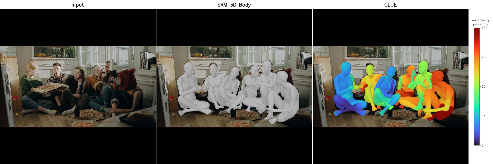

# CLUE inference: 3D human meshes with per-vertex uncertainty

Run **SAM 3D Body**, **SAM 3D Body (CLUE)** and **CLUE** on your own images and videos. For every person, each model predicts the [MHR](https://github.com/facebookresearch/MHR) body mesh, and the CLUE models also predict how uncertain each
of the mesh's 18,439 vertices is. A variance head predicts the variance of the body-model parameters, and CLUE propagates it through the rig in closed form, so every vertex gets its own uncertainty at no sampling cost.

- **SAM 3D Body**: Meta's released model.
- **SAM 3D Body (CLUE)**: Meta's released model, unchanged, with CLUE's uncertainty head trained on top of it. If you already use SAM 3D Body, you can add the head without changing anything else ([below](#adding-uncertainty-to-your-sam-3d-body-setup)).
- **CLUE**: SAM 3D Body's architecture with its decoder and heads trained with CLUE.

Paper: [Modeling Uncertainty Propagation in 3D Morphable Models](https://arxiv.org/abs/2610.24646).
Online demo: [meghshukla/clue-demo](https://huggingface.co/spaces/meghshukla/clue-demo).



The output shows the input image, SAM 3D Body (grey meshes), SAM 3D Body (CLUE) and CLUE (meshes coloured by uncertainty), all run on the same people with the same camera. **Colours** show the per-vertex uncertainty between 0 and 1.

## Setup

1. **Install the packages.** The repository's Docker image has them all (main README, Installation):
   `docker-compose run --rm clue` from the repository's root. Otherwise, install the PyTorch build for your CUDA version
   first ([pytorch.org](https://pytorch.org)), then
   ```bash
   pip install -r requirements.txt
   ```
2. **Put the models in `assets/`.** All models are read from this folder:

   | file | model | from |
   |---|---|---|
   | `assets/clue.safetensors` | CLUE: decoder, heads and variance head (207 MB) | [meghshukla/clue](https://huggingface.co/meghshukla/clue) |
   | `assets/sam3dbody_clue.safetensors` | SAM 3D Body (CLUE): the variance head (6 MB) | the same repository |
   | `assets/sam-3d-body-dinov3/model.ckpt` | SAM 3D Body, with its DINOv3 backbone (2.1 GB) | [facebook/sam-3d-body-dinov3](https://huggingface.co/facebook/sam-3d-body-dinov3) |
   | `assets/sam-3d-body-dinov3/assets/mhr_model.pt` | MHR rig (0.7 GB) | the same release |

   Both repositories are gated, hence please accept their terms on Hugging Face (CLUE's are approved automatically, Meta's once Meta grants access). and log in with `hf auth login`. CLUE's gate exists to ensure that users comply with SAM 3D Body's license too. Missing files are downloaded into `assets/` on the first run; to download them yourself, from this folder:
   ```bash
   hf download meghshukla/clue clue.safetensors sam3dbody_clue.safetensors --local-dir assets
   hf download facebook/sam-3d-body-dinov3 model.ckpt assets/mhr_model.pt --local-dir assets/sam-3d-body-dinov3
   ```

The first run also downloads DINOv3's model code from GitHub (a fixed commit) and torchvision's person detector. CLUE's uncertainty code is imported from the repository's `MHR` folder (`MHR/algorithm.py`, `MHR/model_loader.py`).

## Usage

```bash
python run.py --input examples/six_friends.jpg examples/video.mp4 --output results
python run.py --input examples/ --output results                                   # every image and video in a folder (video.mp4 takes minutes)
python run.py --input my_video.mp4 --output results --model clue                   # Input | CLUE only
python run.py --input my_photo.jpg --output results --model sam3dbody_clue clue    # Input | SAM 3D Body (CLUE) | CLUE
```

Images are written to `results/<name>.jpg`, videos to `results/<name>.mp4` (H.264, no audio).

| option | default | |
|---|---|---|
| `--model` | all three | one or more of `sam3dbody`, `sam3dbody_clue`, `clue`: Input \| those models (only those run) |
| `--device` | `cuda` if available | `cpu` works but is slow (tens of seconds per person) |
| `--max-side-image` | 1600 | images are downscaled to this long side |
| `--max-side-video` | 1280 | videos are downscaled to this long side |
| `--max-seconds` | whole video | only the first seconds of each video |

From Python:

```python
import sys; sys.path.insert(0, "path/to/inference")
import cv2
from clue_inference.pipeline import Pipeline

pipeline = Pipeline()                                     # or e.g. Pipeline(("clue",)), Pipeline(("sam3dbody_clue", "clue"))
panels, report = pipeline.image(cv2.cvtColor(cv2.imread("photo.jpg"), cv2.COLOR_BGR2RGB))
report = pipeline.video("clip.mp4", "clip_out.mp4")
```

## Adding uncertainty to your SAM 3D Body setup

If you already run Meta's [sam-3d-body](https://github.com/facebookresearch/sam-3d-body) code, the standalone plugin in
[`plugin/`](plugin/README.md) adds SAM 3D Body (CLUE)'s per-vertex uncertainty to it, without changing SAM 3D Body's own
outputs:

```python
from sam3dbody_clue import SAM3DBodyCLUE                 # pip install path/to/plugin

clue = SAM3DBodyCLUE(estimator)                          # Add a hook to integrate CLUE into SAM 3D Body

# CLUE supported for inference_type = 'body', for 'full' original code behaviour maintained without CLUE
outputs = estimator.process_one_image(image, inference_type="body")   # outputs[i]["vertex_sigma_cm"]: per-vertex std in cm
```

Tested with Meta's sam-3d-body at commit [`b5c765a`](https://github.com/facebookresearch/sam-3d-body/commit/b5c765a0d89d789985e186d396315e7590887b94) (2026-02-19), the latest commit at the time of writing.


## Results

| | Training images | Per-vertex uncertainty | 3DPW <sub>MPJPE / PA-MPJPE / PVE / PA-PVE</sub> | EMDB <sub>MPJPE / PA-MPJPE / PVE / PA-PVE</sub> |
|---|:-:|:-:|:-:|:-:|
| SAM 3D Body | 3.8M | ✗ | 56.0 / 35.1 / 67.1 / 47.2 | **63.2 / 38.2 / 74.7 / 47.1** |
| CLUE | **1.2M** | ✓ | **55.8 / 34.5 / 66.4 / 46.7** | 64.9 / 39.7 / 77.0 / 49.0 |

Errors in mm on the 3DPW test set and EMDB 1 (lower is better), and all models are evaluated with the same protocol.
SAM 3D Body (CLUE) leaves SAM 3D Body's meshes unchanged, so its errors are those of SAM 3D Body.

## Folder contents

| path | content | licence |
|---|---|---|
| `run.py`, `clue_inference/` | CLUE's inference code | BSD-3-Clause-Clear (`LICENSE`) |
| `plugin/` | SAM 3D Body (CLUE) as a standalone plugin for Meta's sam-3d-body code | BSD-3-Clause-Clear (`plugin/LICENSE`) |
| `assets/` | The models (Setup), not part of the repository | SAM License (CLUE, SAM 3D Body (CLUE), SAM 3D Body), Apache 2.0 (MHR rig) |
| `sam_3d_body/`, `model_config.yaml` | SAM 3D Body's model code | SAM License (`sam_3d_body/LICENSE`) |
| `percentiles/clue.npz`, `percentiles/sam3dbody_clue.npz` | The references for the colours: each vertex's uncertainty at 401 quantile levels over 6,118 person-frames of in-the-wild video, per model | |
| `examples/` | Stills and clips from videos on [Pexels](https://www.pexels.com), and `video.mp4`, the 2-minute compilation of Pexels clips they come from (stored with Git LFS) | [Pexels License](https://www.pexels.com/license/) |

## Licence and attribution

CLUE's code is released under the BSD-3-Clause-Clear License (`LICENSE`), which grants no patent rights. CLUE's weights build on Meta's SAM 3D Body and are released under the SAM License ([meghshukla/clue](https://huggingface.co/meghshukla/clue)). Third-party parts keep their own licences. If you use CLUE's code, weights or results, please cite the paper :)

## Citation

```bibtex
@misc{shukla2026modelinguncertaintypropagation3d,
      title={Modeling Uncertainty Propagation in 3D Morphable Models}, 
      author={Megh Shukla and Edo Collins and Prashanth Chandran and Karel Petránek and Sergio Orts-Escolano and Mathieu Salzmann and Alexandre Alahi},
      year={2026},
      eprint={2610.24646},
      archivePrefix={arXiv},
      primaryClass={cs.CV},
      url={https://arxiv.org/abs/2610.24646}, 
}
```
