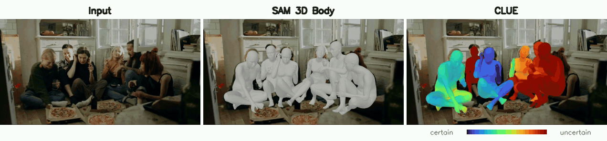
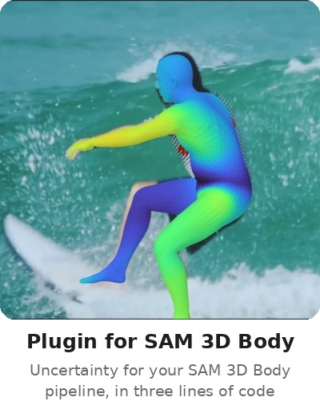
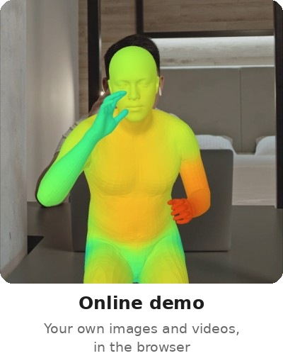
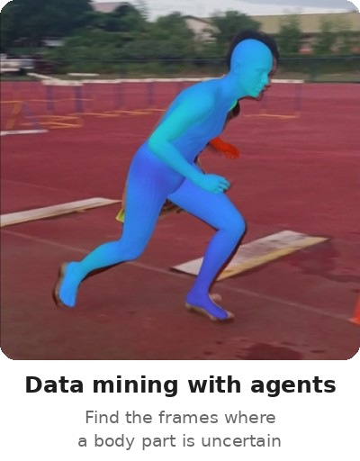
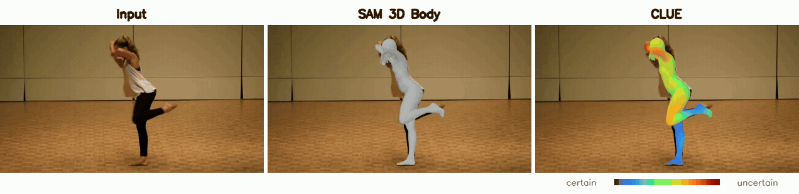

<div align="center">

# Modeling Uncertainty Propagation in 3D Morphable Models

**_Closed-form, per-vertex uncertainty for 3D faces and bodies, and for SAM 3D Body in three lines of code._**

Megh Shukla<sup>1</sup> · Edo Collins<sup>2</sup> · Prashanth Chandran<sup>2</sup> · Karel Petránek<sup>2</sup> · Sergio Orts-Escolano<sup>2</sup> · Mathieu Salzmann<sup>1,3</sup> · Alexandre Alahi<sup>1</sup>

<sup>1</sup>EPFL &nbsp;&nbsp; <sup>2</sup>Google &nbsp;&nbsp; <sup>3</sup>Waabi

<a href="https://arxiv.org/abs/2610.24646"></a> <a href="https://huggingface.co/spaces/meghshukla/clue-demo"></a> <a href="https://huggingface.co/meghshukla/clue"></a> <a href="https://hub.docker.com/r/meghshukla/clue"></a> 


<sub>CLUE colours every vertex of its mesh by how uncertain it is, from blue (certain) to red (uncertain).</sub>

</div>

**CLUE** maps the variance of a 3D morphable model's parameters to the variance of every vertex of its mesh, in closed form. This does not require sampling or computing expensive Jacobians. CLUE is accurate and computationally efficient for real time inference. Not only does CLUE make uncertainty visually interpretable, it also improves accuracy in comparison to deterministic and architecture agnostic unimodal baselines.

<p align="center">
<a href="#plugin"></a>
<a href="https://huggingface.co/spaces/meghshukla/clue-demo"></a>
<a href="#data-mining"></a>
</p>


## SAM 3D Body (CLUE): uncertainty for your SAM 3D Body pipeline <a name="plugin"></a>

Already using Meta's [SAM 3D Body](https://github.com/facebookresearch/sam-3d-body)? The plugin in [`ITW/inference/plugin`](ITW/inference/plugin) adds a per-vertex uncertainty map to every mesh it predicts, with three lines of code. SAM 3D Body stays exactly as it is. The plugin reads its decoder through a hook, a 6 MB head trained on top of the frozen released model predicts the variance of the body parameters, and CLUE propagates this variance through the MHR rig in closed form. Meshes, keypoints and cameras do not change.

```bash
pip install ITW/inference/plugin
```

```python
from sam3dbody_clue import SAM3DBodyCLUE

clue = SAM3DBodyCLUE(estimator)                 # Add a hook to integrate CLUE into SAM 3D Body

# CLUE supported for inference_type = 'body', for 'full' original code behaviour maintained without CLUE
outputs = estimator.process_one_image(image, inference_type="body")   # outputs[i]["vertex_sigma_cm"]: per-vertex std in cm
```

The head's weights are downloaded from [meghshukla/clue](https://huggingface.co/meghshukla/clue) on first use.  The repository is gated with automatic approval so please accept its terms once and log in with `hf auth login`. The gate exists to ensure that users comply with SAM 3D Body's license too. This code is tested with sam-3d-body at commit [`b5c765a`](https://github.com/facebookresearch/sam-3d-body/commit/b5c765a0d89d789985e186d396315e7590887b94), which is the latest commit as of the time of writing. Details are provided in [`ITW/inference/plugin/README.md`](ITW/inference/plugin/README.md).


## Try CLUE in your browser <a name="demo"></a>

**[Hugging Face demo: meghshukla/clue-demo](https://huggingface.co/spaces/meghshukla/clue-demo)**. No installation needed. Upload an image, take one with your webcam, or upload a video (its first 10 s are processed). For every person, the demo shows the input, Meta's SAM 3D Body (grey mesh) and CLUE (mesh coloured by per-vertex uncertainty) side by side.


## Data mining with coding agents <a name="data-mining"></a>

Ask a coding agent to *"find the frames where the left arm is most uncertain"* or *"find the people whose body shape is hard to estimate"*. The [`data-mining`](data-mining) folder is an [Agent Skill](https://agentskills.io): it ranks the people in a folder of images or a video with CLUE and returns the frames, or exports every person's scores for curating a dataset. Link the folder into the folder where your agent loads skills from (link it, please don't copy it):

```bash
ln -s "$PWD/data-mining" <skills folder>/data-mining
```


## Results <a name="results"></a>

| | Training images | Per-vertex uncertainty | 3DPW <sub>MPJPE / PA-MPJPE / PVE / PA-PVE</sub> | EMDB <sub>MPJPE / PA-MPJPE / PVE / PA-PVE</sub> |
|---|:-:|:-:|:-:|:-:|
| SAM 3D Body | 3.8M | ✗ | 56.0 / 35.1 / 67.1 / 47.2 | **63.2 / 38.2 / 74.7 / 47.1** |
| CLUE | **1.2M** | ✓ | **55.8 / 34.5 / 66.4 / 46.7** | 64.9 / 39.7 / 77.0 / 49.0 |

<sub>Errors in mm on the 3DPW test set and EMDB 1 (lower is better), and all models are evaluated with the same protocol.
SAM 3D Body (CLUE) leaves SAM 3D Body's meshes unchanged, so its errors are those of SAM 3D Body.</sub>




## Installation <a name="installation"></a>

**Docker (recommended)**: We provide a Docker image which is pre-installed with all required packages. We recommend using this image to ensure reproducibility of our results. Using this image requires setting up [Docker](https://docs.docker.com/engine/install/ubuntu/#installation-methods) on Ubuntu, and the [NVIDIA Container Toolkit](https://docs.nvidia.com/datacenter/cloud-native/container-toolkit/latest/install-guide.html) for GPU access. Once installed, the provided `docker-compose.yaml` starts our environment:

```bash
docker-compose run --rm clue
```

**pip**: In case using Docker is not possible, we recommend setting up a new [virtual environment](https://packaging.python.org/en/latest/guides/installing-using-pip-and-virtual-environments/), installing the PyTorch build for your CUDA version ([pytorch.org](https://pytorch.org)), and then the remaining packages:

```bash
pip install -r requirements.txt
sudo apt install ffmpeg python3-tk          # the videos need ffmpeg, the interactive viewers Tkinter
```


## Repository <a name="organization"></a>

The repository contains three folders for the morphable-model experiments, `FLAME`, `SMPLX` and `MHR`, and two folders for in-the-wild human mesh recovery, `ITW/inference` and `data-mining`.

**FLAME, SMPLX, MHR**: Each folder contains CLUE for that model (`algorithm.py`) and three scripts: `evaluation.py` compares CLUE with Monte-Carlo sampling and a Jacobian baseline, `video.py` renders parameter sweeps with their uncertainty, and `demo.py` is an interactive viewer. These experiments run on a CPU. Running `evaluation.py` writes the error maps (`results/error_maps/`) and the runtime, memory and FLOPs tables (`results/time/`, `results/memory/`, `results/flops/`), measured on your machine. The experiments require the model files, which are distributed under their own licences:

<details>
<summary>Model files for FLAME, SMPL-X and MHR</summary>
<br>

1. FLAME: `generic_model.pkl` from the [FLAME website](https://flame.is.tue.mpg.de), and `flame_static_embedding.pkl`, `flame_dynamic_embedding.npy` from [FLAME_PyTorch](https://github.com/soubhiksanyal/FLAME_PyTorch), copied into `FLAME/model/`.
2. SMPL-X: `SMPLX_NEUTRAL.npz` from the [SMPL-X website](https://smpl-x.is.tue.mpg.de), copied into `SMPLX/models/smplx/`.
3. MHR: the assets of the [MHR release](https://github.com/facebookresearch/MHR), downloaded within `MHR`, which creates `MHR/assets/`:

   ```bash
   curl -OL https://github.com/facebookresearch/MHR/releases/download/v1.0.0/assets.zip && unzip assets.zip
   ```

</details>
<br><br>

**ITW/inference**: Runs SAM 3D Body, SAM 3D Body (CLUE) and CLUE on images and videos. CLUE is SAM 3D Body's architecture with its decoder and heads trained with CLUE from scratch. SAM 3D Body (CLUE) is Meta's released model unchanged, with CLUE's uncertainty head trained on top of it. All models are read from `ITW/inference/assets/`. Missing models are downloaded there on the first run from [meghshukla/clue](https://huggingface.co/meghshukla/clue) and [facebook/sam-3d-body-dinov3](https://huggingface.co/facebook/sam-3d-body-dinov3). Both repositories are gated so please accept their terms on Hugging Face and log in with `hf auth login`. The folder `ITW/inference/plugin` is the standalone plugin described above. Further details are in [`ITW/inference/README.md`](ITW/inference/README.md) and [`ITW/inference/plugin/README.md`](ITW/inference/plugin/README.md).

<br><br>

**data-mining**: Uses CLUE to find the images or video frames in which a body part (arm, hand, leg, foot, head, ...) or the body shape is most uncertain, or most certain, and exports every person's scores for data curation. `mine.py` runs the queries, and `SKILL.md` makes the folder an [Agent Skill](https://agentskills.io) for coding agents. Please link the folder into your agent's skills folder and do not copy it: `mine.py` runs CLUE from `ITW/inference` next to it, so it only works inside the repository.


## Usage <a name="execution"></a>

Start the container with `docker-compose run --rm clue`, or activate the virtual environment with the packages installed via `pip`.

**FLAME, SMPLX, MHR**: The experiments are run from within each folder.

```bash
cd FLAME                    # or SMPLX, MHR
python evaluation.py        # error maps -> results/error_maps/, cost tables -> results/{time,memory,flops}/ (JSON and CSV)
python video.py             # one MP4 per parameter sweep -> results/videos/
python demo.py              # the interactive viewer, which requires a display
```

`evaluation.py --qualitative` renders only the error maps, and `evaluation.py --set_parameters --seed 0` computes the error maps on random faces or bodies instead of the neutral one.
<br><br>

**ITW/inference**: Images and videos are processed from within `ITW/inference`. The input can also be a folder, and `--model` selects any of `sam3dbody`, `sam3dbody_clue` and `clue` (all three by default).

```bash
cd ITW/inference
python run.py --input examples/six_friends.jpg examples/video.mp4 --output results   # -> results/six_friends.jpg, results/video.mp4
```

<br><br>

**data-mining**: Queries are run from within `data-mining`. Each query creates a new folder `queries/<query>__<input>/` with two rankings of people: those whose part stands out most from the rest of their body, and those whose part is most uncertain. `--certain` asks for the most certain people instead, `--shape` ranks the body shape, and `--export scores.csv` writes every person's scores to one table.

```bash
cd data-mining
python mine.py --input ../ITW/inference/examples/video.mp4 --part arm --query "find frames where the arm is most uncertain"
```

A running container is stopped with `docker stop <container id>` (`docker ps` lists the running containers).


## License <a name="license"></a>

CLUE's code is released under the BSD-3-Clause-Clear License, which grants no patent rights. CLUE's weights build on SAM 3D Body and are released under the SAM License. Third-party code and models keep their own licences (see `NOTICE`).


## Acknowledgement <a name="acknowledgement"></a>

We thank Meta for releasing [SAM 3D Body](https://github.com/facebookresearch/sam-3d-body), [MHR](https://github.com/facebookresearch/MHR) and [DINOv3](https://github.com/facebookresearch/dinov3), on which our in-the-wild experiments build. We also thank [POCO](https://github.com/saidwivedi/POCO) for providing an open-source ITW pipeline as our starting point.

We use the [FLAME](https://flame.is.tue.mpg.de) and [SMPL-X](https://smpl-x.is.tue.mpg.de) models with the [FLAME_PyTorch](https://github.com/soubhiksanyal/FLAME_PyTorch) and [smplx](https://github.com/vchoutas/smplx) code. The example images and videos are from [Pexels](https://www.pexels.com).


## Citation <a name="citation"></a>

If you find this work useful, please consider starring this repository and citing this work!

```bibtex
@misc{shukla2026modelinguncertaintypropagation3d,
      title={Modeling Uncertainty Propagation in 3D Morphable Models},
      author={Megh Shukla and Edo Collins and Prashanth Chandran and Karel Petránek and Sergio Orts-Escolano and Mathieu Salzmann and Alexandre Alahi},
      year={2026},
      eprint={2610.24646},
      archivePrefix={arXiv},
      primaryClass={cs.CV},
      url={https://arxiv.org/abs/2610.24646},
}
```
